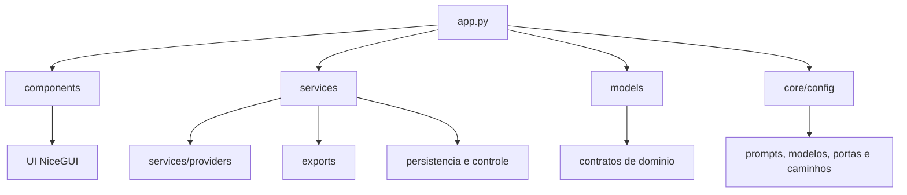
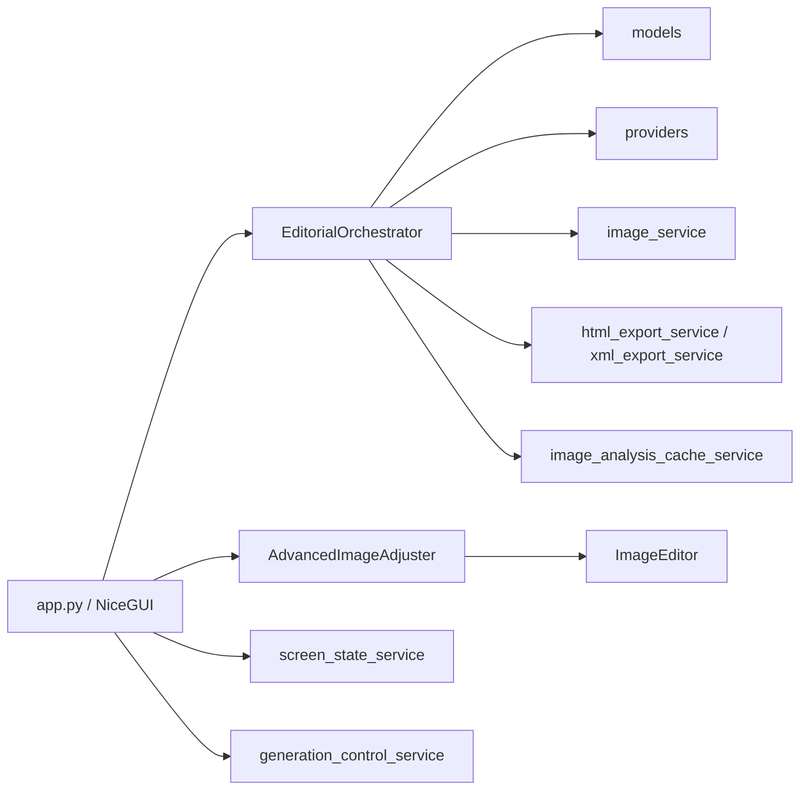

# 02 - Arquitetura

## Visao geral

O projeto segue uma arquitetura em camadas simples:

- `app.py` concentra a interface NiceGUI e orquestra o fluxo da experiencia do usuario;
- `components/` contem os blocos de interface reutilizaveis;
- `models/` define os contratos de dominio;
- `services/` implementa a logica de negocio, IA, exportacao, persistencia e utilitarios;
- `core/config/` centraliza configuracoes de modelos, prompts e caminhos;
- `tests/` valida o comportamento principal do sistema.

## Estrutura de pastas

## Responsabilidade de cada pasta

### `app.py`

Ponto de entrada da aplicacao. Cria a pagina principal, carrega estado salvo, inicializa workspace, executa a geracao automatica, apresenta a revisao e dispara a exportacao.

### `components/`

Componentes de interface:

- `novelty_preview.py`: renderizacao da novidade na tela de visualizacao;
- `composition_builder.py`: edicao manual da composicao textual e posicao dos blocos;
- `advanced_image_adjuster.py`: ajustes avancados das imagens e anotacoes;
- `image_editor.py`: logica de rascunho, confirmacao e historico de anotacoes.

### `models/`

Estruturas de dominio:

- `CompositionDocument` e `ContentBlock` controlam a novidade e seus blocos;
- `Annotation` e `AnnotationDocument` controlam anotacoes de imagem;
- `NoveltyPlan`, `PlannedBlock`, `FidelityReview` e outros modelos definem o contrato das respostas da IA;
- `EditorialUnit` representa a estruturacao deterministica do texto de entrada.

### `services/`

Camada funcional do sistema:

- `editorial_orchestration_service.py`: fluxo principal editorial;
- `novelty_generation_service.py`: aplicacao de marcacoes e fluxo automatico de novidade;
- `image_service.py`: manipulacao de imagens, desenho com Pillow e exportacoes;
- `html_export_service.py` e `xml_export_service.py`: geracao dos artefatos finais;
- `screen_state_service.py`: persistencia do estado da tela;
- `generation_control_service.py`: bloqueio e idempotencia de geracao;
- `api_usage_service.py`: auditoria de chamadas de IA e estimativa de custo;
- `model_routing.py`: validacao e roteamento de modelos;
- `text_sanitizer.py`: limpeza de markdown;
- `system_path_formatter.py`: normalizacao de caminhos do sistema;
- `image_analysis_cache_service.py`: cache de analise de imagem;
- `composition_ai_service.py`: servicos auxiliares de revisao e sugestao;
- `providers/`: providers OpenAI e Gemini.

### `core/config/`

Configuracoes centrais:

- labels dos provedores;
- modelos padrao;
- variaveis de ambiente das chaves;
- caminhos de prompts;
- base do HTML de exportacao.

## Fluxo entre modulos

## Dependencias internas relevantes

- `app.py` depende de `EditorialOrchestrator`, `CompositionBuilder`, `AdvancedImageAdjuster`, `ImageEditor`, `ScreenStateStore`, `SessionWorkspace` e `ProviderFactory`;
- `EditorialOrchestrator` depende de `AIProvider`, `NoveltyPlan`, `FidelityReview`, `CompositionDocument`, `ImageAnalysisCache`, `extract_editorial_units`, `format_system_navigation` e exportadores;
- `ImageEditor` depende de `Annotation` e `AnnotationDocument`;
- os providers dependem de `models.novelty_plan`, `services.image_service`, `services.model_routing` e `services.providers.exceptions`.

